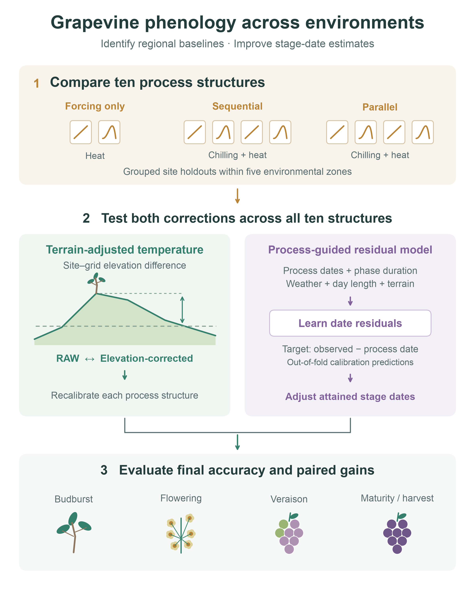
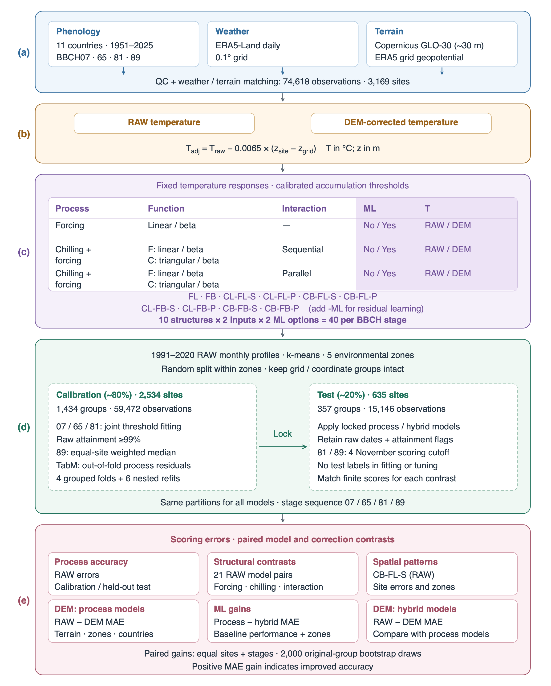

# Grapevine phenology across European environments

**Beyond thermal accumulation: improving cross-regional grapevine phenology prediction with terrain-aware forcing and residual learning**

Linjia Yao, Qiang Yu and Gang Zhao

[Manuscript PDF](paper/manuscript.pdf) · [Manuscript Word](paper/manuscript.docx) · [Supplementary PDF](paper/supplementary.pdf) · [Supplementary Word](paper/supplementary.docx) · [Complete submission Word](paper/submission_complete.docx)

[Research background](#research-background-and-objectives) · [Methods](#model-comparison-and-validation-design) · [Main findings](#main-findings) · [Article guide](#article-and-figure-guide) · [Reproduction](#verify-and-reproduce-the-published-results)

This repository contains the observations, model implementations, fitted parameters, predictions, figures and submission documents for a European grapevine phenology study. The analysis evaluates **ten process-based model structures**, **two temperature inputs** and **the absence or presence of residual machine learning**, giving **40 configurations for each of four developmental stages**. Its final population comprises **74,618 observations at 3,169 reported sites in 11 countries during 1951–2025**, with complete groups of sites held out for testing.



## Research background and objectives

Grapevine developmental timing determines the weather encountered during budburst, flowering and ripening. Errors in these dates affect estimates of frost exposure, seasonal water demand and the environmental conditions experienced by developing berries. Regional phenology estimation must accommodate differences in climate, terrain, reported varieties and monitoring practices across vineyards.

Temperature accumulation provides a practical basis for predicting these stages, but two sources of error remain distinct. Process formulations differ in their representation of heat accumulation, winter chilling and the transition from dormancy to growth. Gridded weather also represents conditions at a coarser scale than individual vineyard terrain. A digital elevation model (DEM) permits a transparent adjustment for site-to-grid elevation differences, while residual machine learning can estimate systematic discrepancies remaining after process simulation.

The study asks whether these approaches provide additional predictive value when assessed together on the same observations:

1. How accurately do alternative forcing and chilling formulations predict the four grapevine stages at held-out sites?
2. Does DEM-based temperature correction improve prediction after recalibration, and how do its benefits vary with stage and terrain?
3. How much does residual learning reduce error, and which errors remain in the resulting hybrids?
4. Does elevation correction retain its benefit after residual learning, and how do these relationships vary across environmental zones?

The [manuscript](paper/manuscript.tex) provides the scientific rationale and interpretation; the [supplementary information](paper/supplementary.tex) documents additional methods, support counts and sensitivity analyses. Cited literature is retained in the [BibTeX bibliography](paper/references/Phenological.bib).

## Observations and environmental data

Phenological observations originate from **TEMPO, DWD and PEP725**. Records preserve directly reported BBCH codes, dates, varieties, coordinates and source identities. Exact duplicates, provider-quality conflicts and unsupported seasonal or stage-pair timing are screened with recoverable exclusion evidence. Accepted repeated observations remain separate, and a site-year can contribute any target stage without a complete developmental sequence.

| Target | Developmental stage | Held-out observations |
| --- | --- | ---: |
| BBCH07 | Beginning of budburst | 5,073 |
| BBCH65 | Full flowering | 5,469 |
| BBCH81 | Beginning of ripening, or veraison | 3,754 |
| BBCH89 | Maturity/harvest | 850 |

BBCH07 remains distinct from BBCH09. Maturity/harvest is a source-dependent operational endpoint: harvest timing can reflect management decisions as well as physiological development.

The revised four-target inventory retains 75,738 observations after screening. Matching to the unchanged weather-complete site-years, coordinates and site identities excludes a further 1,120 records, yielding the final modelling population:

| Population | Observations | Reported sites | Independence groups |
| --- | ---: | ---: | ---: |
| Calibration | 59,472 | 2,534 | 1,434 |
| Held-out testing | 15,146 | 635 | 357 |
| Total | **74,618** | **3,169** | **1,791** |

The population spans 26,443 site-years. Reported site identifiers can describe overlapping physical locations; sites sharing weather cells or coordinates are joined into groups for validation. Germany contributes 74.7% of observations, and France supplies 93.7% of maturity/harvest records. Seven countries contribute to the test population. These differences limit the geographic interpretation of stage-specific performance.

Daily mean 2-m temperature comes from **ERA5-Land at its native 0.1° grid**. Every retained site-year has finite forcing from 4 June of the preceding year through 31 December of the observation year, covering chilling accumulation and residual-model weather histories. **Copernicus GLO-30** supplies site elevation and terrain predictors; official ERA5-Land invariant geopotential supplies weather-grid elevation.

The paired temperature treatments are:

```text
T_DEM = T_RAW − 0.0065 × (z_site − z_grid)
```

Temperatures are in °C and elevations in metres. A site 100 m above its weather-grid elevation receives a −0.65 °C adjustment. The fixed lapse rate does not represent local inversions or seasonal changes in vertical temperature gradients. Process thresholds are recalibrated separately under RAW and DEM inputs, so the comparison measures the performance of each fitted workflow.

## Model comparison and validation design

### Factorial process models

The model catalogue crosses forcing response, chilling response, chilling–forcing interaction, residual learning and temperature input:

| Process | Function | Interaction | ML | T |
| --- | --- | --- | --- | --- |
| Forcing | Linear / beta | — | No / Yes | RAW / DEM |
| Chilling + forcing | F: linear / beta; C: triangular / beta | Sequential | No / Yes | RAW / DEM |
| Chilling + forcing | F: linear / beta; C: triangular / beta | Parallel | No / Yes | RAW / DEM |

The three rows contain two, four and four process structures, respectively. Their identifiers are **FL, FB, CL-FL-S, CL-FL-P, CB-FL-S, CB-FL-P, CL-FB-S, CL-FB-P, CB-FB-S and CB-FB-P**. The suffixes `-S` and `-P` distinguish sequential and parallel interaction; residual-learning variants append `-ML`.

Temperature-response functions are fixed within the tested parameterization, while accumulation requirements are estimated from calibration observations. Budburst, flowering and veraison thresholds are fitted jointly using equal-site and equal-stage MAE, with bias and raw-attainment constraints. Maturity requirements follow an equal-site weighted median. Development proceeds from predicted preceding stages; observed preceding-stage dates do not initialize predictions.

### Residual learning

Stage-specific **TabM** models predict the difference between the observed date and the raw process-predicted date. Predictors describe the simulated developmental state, recent temperature histories, day length and terrain. The learned residual adjusts an attained process date, with an ordering step preserving the developmental sequence. It does not change the underlying thermal accumulation or create attainment for a missing process stage.

Four grouped calibration folds generate ordinary out-of-fold process predictions. Six additional process refits exclude pairs of folds, keeping neural-validation labels out of the process fits used to construct residual-training targets. Imputation, scaling and numerical embeddings are fitted within the neural-training folds. Four inner folds select training duration, and three final seeds contribute to the residual prediction. Held-out test labels enter neither final process fitting nor neural tuning.

### Environmental zones and independent testing

Five **environmental zones, EZ01–EZ05**, summarize standardized monthly RAW ERA5-Land temperature profiles for 1991–2020. Clustering uses climate covariates alone, and zone labels run from the coldest to the warmest annual mean centroid. The original centroids use 1,792 weather cells; the 1,791 groups in the final population retain their original zone assignments after revised screening.

An approximately 80/20 calibration–test allocation preserves complete groups within zones. The same allocation applies to all model structures and temperature treatments. Zone-specific results describe subsets of this primary site holdout; they assess prediction within represented thermal environments. Independent regional transfer, unusually warm conditions and operational forecasting require additional evaluation.

### Accuracy, scoring and uncertainty

The primary performance measures are **mean absolute error (MAE)** and **signed bias**, both in days. Positive bias means a predicted date is later than the observed date. Errors are averaged within sites, then equally across sites; overall summaries give each of the four stages equal weight. Opposing errors can cancel in bias even when MAE remains large.

Paired correction comparisons share **15,105 observations at 633 test sites in 355 independence groups**, requiring finite scoring errors across all compared configurations. Aggregate contrasts average errors across the ten fixed structures; they do not form an ensemble of process predictions. Pointwise 95% intervals use **2,000 bootstrap samples of the original independence groups**, with at least ten contributing groups required per stage for an interval.

Late or unattained BBCH81/89 predictions receive a common **4 November administrative scoring date**. Raw dates, developmental attainment and cutoff-assignment flags remain separate. This convention supports comparable scoring without implying that an assigned date is an attained physiological event. RMSE appears only in supplementary diagnostics.



## Main findings

### Process structure affects predictive accuracy

Across RAW process models, four-stage held-out MAE ranges from **11.31 to 14.74 days** on each model's finite-scoring population. **CB-FL-S** has the lowest descriptive MAE, at 11.31 days. Controlled comparisons favour linear over beta forcing by **1.26 days** (95% interval: 0.96–1.57) and sequential over parallel chilling–forcing by **1.41 days** (1.12–1.67). These results are conditional on the fixed response functions and calibration constraints.

Later stages remain challenging: model-specific MAE ranges from **12.33–15.20 days for veraison** and **12.62–15.78 days for maturity/harvest**. All ten RAW process models predict veraison too early on average. Small overall calibration–test differences therefore coexist with substantial individual errors and systematic stage-specific bias. Evidence: [Fig. 5](fig/paper_figures/Fig_05.pdf), [Fig. 6](fig/paper_figures/Fig_06.pdf) and [Supplementary Fig. S1](fig/paper_figures/Fig_S01.pdf).

### DEM correction and residual learning provide different gains

The common paired population supports the following comparisons, with positive reductions indicating improved accuracy:

| Held-out comparison | Mean MAE reduction | Pointwise 95% interval |
| --- | ---: | ---: |
| DEM correction within process models | **1.06 days** | 0.70–1.39 days |
| Residual learning with RAW temperature | **4.10 days** | 3.56–4.63 days |
| DEM correction within residual-learning hybrids | **0.12 days** | −0.10–0.31 days |

DEM correction lowers mean process MAE from **12.58 to 11.53 days**, an 8.4% reduction. Flowering benefits most, with a 1.61-day reduction. Average improvements coexist with deterioration at some sites, and greater local terrain variability does not consistently imply a greater benefit.

RAW residual learning lowers mean MAE from **12.58 to 8.49 days**. Across structures, the MAE range narrows from **11.27–14.61 days** for process predictions to **8.30–8.75 days** for hybrids on this common population. A model's correction magnitude and its final accuracy can give different rankings: a large gain can result from a weak process baseline.

The DEM benefit is **0.94 days smaller after residual learning** (95% interval: 0.64–1.24). Its remaining 0.12-day average gain has an interval spanning zero. This pattern is consistent with overlapping correction of systematic errors, without identifying their physical or biological causes. Reductions are calculated from unrounded paired estimates, so subtraction of displayed MAEs can differ by 0.01 day. Evidence: [Fig. 8](fig/paper_figures/Fig_08.pdf), [Fig. 9](fig/paper_figures/Fig_09.pdf), [Fig. 10](fig/paper_figures/Fig_10.pdf) and the [paired DEM-benefit analysis](data/paper_figures/ml_baseline_link/paired_dem_gain_decrease.csv).

### Environmental zones reveal stage-specific differences

For flowering, RAW residual learning reverses the relative error levels of EZ03 and the warmest zone, EZ05:

| Environmental zone | Process MAE | Hybrid MAE | ML reduction and 95% interval |
| --- | ---: | ---: | ---: |
| EZ03 | 9.06 days | 7.62 days | **1.44 days** (0.89–1.99) |
| EZ05 | 15.12 days | 4.54 days | **10.58 days** (9.12–11.99) |

DEM effects also depend on the zone–stage combination. Process-model veraison MAE improves by **2.22 days in EZ05**, while the EZ04 point estimate indicates a **0.59-day deterioration**, with its interval spanning zero. After residual learning, additional DEM gains retain positive intervals for budburst and flowering in EZ04, but all four stage intervals include zero in EZ05.

Sparse support limits inference near the environmental margins. EZ01 contains flowering observations only, and maturity/harvest has few contributing groups in EZ02 and EZ03. Zone differences also reflect the sampled varieties, years and management settings; they do not establish a causal or monotonic relationship between temperature and correction benefit. Evidence: [Fig. 7](fig/paper_figures/Fig_07.pdf), [Fig. 9](fig/paper_figures/Fig_09.pdf), [Fig. 10](fig/paper_figures/Fig_10.pdf) and [Supplementary Tables S7–S8](paper/supplementary.pdf).

## Scientific interpretation and scope

Model selection benefits from assessing process formulation, weather inputs and residual learning together. Improvements measured separately need not persist when corrections are combined. Final stage-specific error, environmental coverage and raw developmental attainment are relevant alongside the size of an average gain. DEM correction retains value for process models, while residual learning offers a larger reduction in date error within the sampled environments.

The results support retrospective phenology estimation using realized weather through the process-predicted date. They do not establish forecast skill at a fixed advance issue date, future-climate transfer, improved yield estimates or management benefits. Terrain associations do not identify causal effects, and greater phenological accuracy alone does not demonstrate more accurate local temperatures. Climate-change projections and GCM downscaling are outside the study.

Geographic imbalance, ambiguous cultivar or plant identities and the operational interpretation of harvest constrain biological generalization. Screening and calibration procedures were revised after preliminary model results became available. Although final fitting and tuning exclude test labels, the full development process consequently lacks a prospectively untouched evaluation cohort. Independent vineyard observations, consistent cultivar-resolved endpoints and dedicated regional and warm-season tests are needed to assess wider applicability.

## Article and figure guide

| Article component | Files and content |
| --- | --- |
| Main manuscript | [PDF](paper/manuscript.pdf), [Word](paper/manuscript.docx), [LaTeX](paper/manuscript.tex) |
| Supplementary information | [PDF](paper/supplementary.pdf), [Word](paper/supplementary.docx), [LaTeX](paper/supplementary.tex): additional methods, bias diagnostics, sample support and sensitivities |
| Complete submission | [Word](paper/submission_complete.docx): front matter, manuscript and appended supplement |
| Graphical abstract | [PDF](fig/graphical_abstract/graphical_abstract.pdf), [SVG](fig/graphical_abstract/graphical_abstract.svg), [PNG](fig/graphical_abstract/graphical_abstract.png) |
| Study design | [Fig. 1](fig/paper_figures/Fig_01.pdf): workflow; [Fig. 2](fig/paper_figures/Fig_02.pdf): historical observation domain; [Fig. 3](fig/paper_figures/Fig_03.pdf): temperature responses; [Fig. 4](fig/paper_figures/Fig_04.pdf): environmental zones and partitions |
| Process-model results | [Fig. 5](fig/paper_figures/Fig_05.pdf): MAE; [Fig. 6](fig/paper_figures/Fig_06.pdf): controlled structure contrasts; [Fig. 7](fig/paper_figures/Fig_07.pdf): site errors across zones |
| Correction results | [Fig. 8](fig/paper_figures/Fig_08.pdf): DEM benefits; [Fig. 9](fig/paper_figures/Fig_09.pdf): residual-learning gains and remaining error; [Fig. 10](fig/paper_figures/Fig_10.pdf): DEM effects within hybrids |
| Supporting evidence | [Numerical figure inputs](data/paper_figures/README.md), [scientific evidence](paper/evidence/README.md), [reproduction records](reproducibility/README.md) |

Fig. 2 describes an earlier phenology-only snapshot with **74,341 observations at 3,171 sites**, distinct from the final 74,618-record modelling population. The [complete figure index](fig/paper_figures/README.md) includes all ten main and five supplementary figures.

## Repository layout

| Stage | Entry point | Inputs and outputs |
| --- | --- | --- |
| Data preparation | [`src/data_preparation/`](src/data_preparation/README.md) | Source records, screening, weather eligibility and frozen partitions |
| Model calibration | [`src/calibration/`](src/calibration/README.md) | Pooled initialization, constrained process calibration and nested TabM training |
| Model validation | [`src/validation/`](src/validation/README.md) | Saved source/artifact hashes, prediction dates, attainment and metrics |
| Visualization | [`src/visualization/`](src/visualization/README.md) | All 10 main and 5 supplementary figures; numerical checks from locked predictions |
| Manuscript and Word | [`src/documents/`](src/documents/README.md) | PDFs, Zotero-field DOCX, cover letter, highlights and graphical abstract |
| Numerical engines | `model/`, `model_run/factorial/`, `model_run/src/` | Original model code and calibration engines with frozen source fingerprints |
| Source data | [`data/`](data/README.md) | Canonical observations, weather, terrain, climate and figure inputs |
| Frozen model results | [`model_run/results/`](model_run/README.md) | Fitted parameters, folds, checkpoints, raw/scoring predictions and completion markers |
| Publication artifacts | `fig/paper_figures/`, `fig/graphical_abstract/`, `paper/` | Final figures, manuscripts and submission files |

The numerical engines retain their physical paths and original bytes because the completed runs fingerprint them. Classified entry points call those engines. Dated result directory names identify frozen scientific inputs and dependencies of the final run.

## Setup

Install **Git LFS** before retrieving the large data and model objects:

```sh
git lfs install
git lfs pull
python3 -m venv .venv
.venv/bin/python -m pip install -r requirements.txt
```

The recorded environment uses Python 3.12.14. Statistical verification and training use Python; publication rendering also requires macOS, Swift/Xcode command-line tools, Helvetica and Tectonic. Put `tectonic` on PATH or at `.venv/bin/tectonic`. Pinned Python dependencies are retained with each component. Earth Engine authentication is needed only for renewed acquisition, not replay of the included snapshots. Provider-specific data licences remain applicable; see [`data/README.md`](data/README.md).

## Verify and reproduce the published results

Run from the repository root:

```sh
.venv/bin/python src/data_preparation/reproduce.py --verify
.venv/bin/python src/validation/verify.py
NUMBA_NUM_THREADS=1 .venv/bin/python -m pytest -q
.venv/bin/python src/visualization/reproduce.py --build-documents
.venv/bin/python src/documents/build.py --word-only
```

The visualization command recomputes the plotted statistics and 2,000 original-group bootstrap draws from locked predictions, verifies the saved values, redraws all 15 figures and compiles both PDFs. On macOS, `src/visualization/reproduce.command` provides the same figure/PDF workflow. The document command produces `paper/manuscript.docx`, `paper/supplementary.docx` and `paper/submission_complete.docx`. Temporary files go under ignored `build/`.

The combined Word file places the cover letter, highlights and graphical abstract before the manuscript title, with supplementary material after the manuscript. Body text is double spaced, manuscript line numbers are continuous, tables have borders, and equations are centered. Citations carry embedded Zotero field data; they are not linked to an installed personal Zotero library.

## Recalibrate from the frozen data

```sh
.venv/bin/python src/calibration/run.py --help
.venv/bin/python src/calibration/run.py --output build/recalibration --threads 7
```

The calibration guide distinguishes upstream initialization, process fitting and hybrid fitting. New runs use new output directories; frozen results must not be overwritten. Full optimization and neural fitting are substantial computations. Recalibration has recorded seeds and settings, but timestamps and hardware-dependent stochastic training can prevent byte-identical new model files. The saved artifacts support exact validation without refitting.

The final screening can also be rebuilt from the four included canonical source tables; commands are in the [data-preparation guide](src/data_preparation/README.md). These tables already contain provider-level assembly. Prepared terrain donors and map backgrounds are retained; rebuilding all original terrain rasters requires renewed acquisition. Historical screening sensitivity in supplementary Table S4 is retained as a documented comparison with its available population evidence, separate from the final modelling population.

The [verification record](reproducibility/verification.json) documents population reconstruction, validation in a separate checkout, model-artifact checks, figure recomputation and document reproduction. It distinguishes validation of the saved results from a full model retraining run. Source attribution and provider-specific reuse conditions are indexed in [the data guide](data/README.md).
